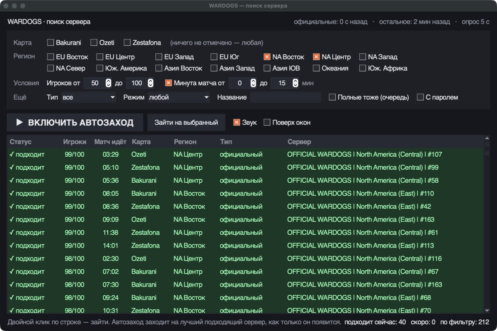
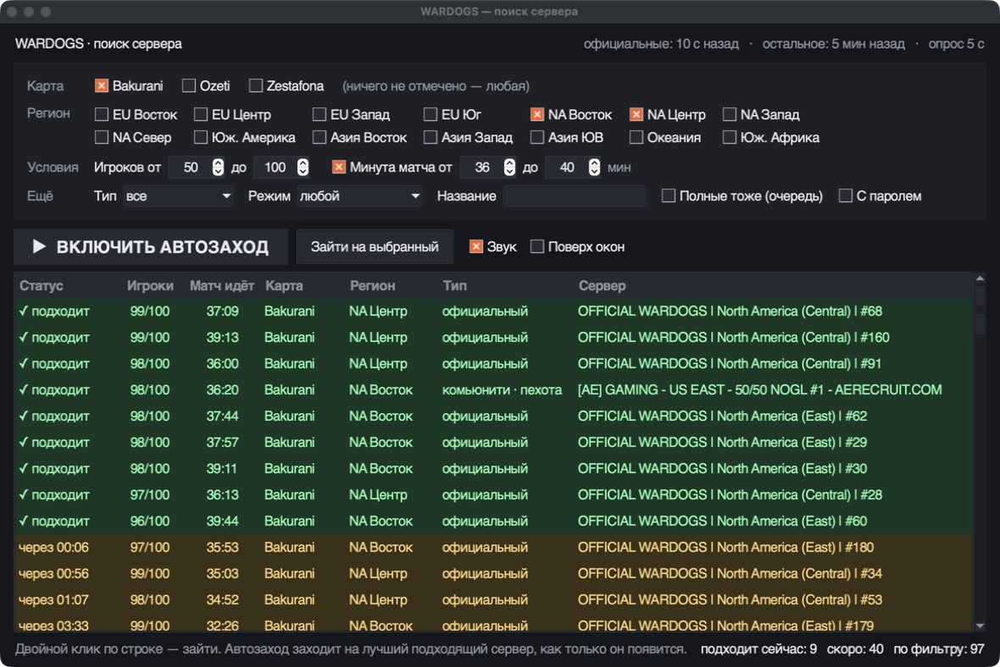
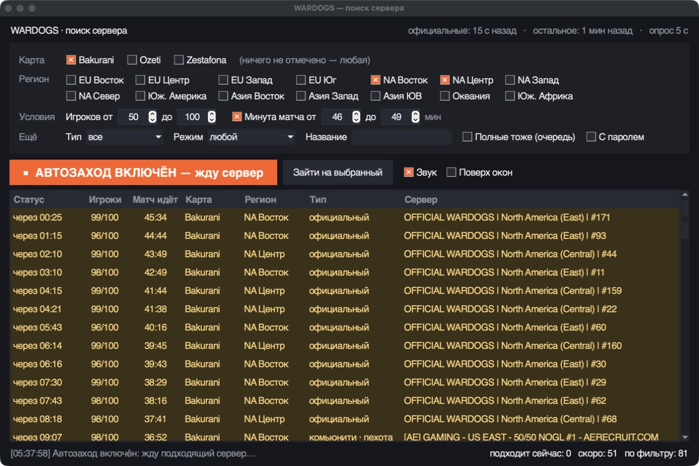
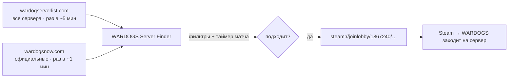

<div align="center">

# 🎯 WARDOGS Server Finder

**Находит сервер WARDOGS, где матч только начался, и сам закидывает тебя туда через Steam.**

Выставил карту, регион, онлайн и минуту матча, нажал «Автозаход» — дальше программа всё сделает сама.




</div>

## Зачем это

Больше не нужно листать меню и искать сервер, на котором игра только началась. Программа следит за всеми серверами сразу, показывает, сколько идёт матч на каждом, и заходит на первый, где совпало всё: карта, регион, число игроков и нужная минута.

## Возможности

- 🗺️ **Фильтры** — карта (Bakurani, Ozeti, Zestafona), 14 регионов, игроков от и до, минута матча от и до, официальные или комьюнити, режим «только пехота», поиск по названию.
- ⏱️ **Живой таймер матча** на каждом сервере, тикает каждую секунду.
- 🟢 🟡 **Подсветка** — зелёные сервера подходят прямо сейчас, жёлтые войдут в нужные минуты «через 02:10».
- 🤖 **Автозаход** — ждёт подходящий сервер и сам заходит на лучший (больше всего игроков), со звуком.
- 🖱️ **Двойной клик** по строке — зайти вручную.
- 💾 Настройки запоминаются, есть режим «поверх окон».
- 🧰 Ничего не надо ставить, кроме Python: только стандартная библиотека.

<table>
  <tr>
    <td width="50%"></td>
    <td width="50%"></td>
  </tr>
  <tr>
    <td>Нужна 36–40 минута на Bakurani: зелёные подходят, жёлтые на подходе</td>
    <td>Автозаход ждёт: ближайший сервер войдёт в окно через 25 секунд</td>
  </tr>
</table>

## Быстрый старт

1. Поставь [Python 3.9+](https://www.python.org/downloads/) (при установке отметь «Add python.exe to PATH»).
2. Скачай репозиторий: **Code → Download ZIP**, распакуй в любую папку.
3. Запусти **`wardogs_gui.pyw`** двойным кликом.
4. Выбери фильтры и нажми **«▶ Включить автозаход»**.

Steam должен быть запущен. Игру можно открыть заранее: тогда Steam просто скажет ей зайти на найденный сервер.

## Как это работает



| Источник | Что берём | Сам обновляется | Как часто спрашиваем |
| --- | --- | --- | --- |
| [wardogserverlist.com](https://wardogserverlist.com/) `/api/servers` | все сервера: карта, онлайн, начало раунда | раз в ~5 минут | каждые 5 с (ответ из CDN) |
| [wardogsnow.com](https://wardogsnow.com/servers/official) | официальные сервера выбранных регионов | раз в ~1 минуту | раз в 60 с |

Время матча считается на твоём компьютере от момента начала раунда, поэтому секунды точные. Задержка источников влияет только на то, как быстро программа заметит **новый** раунд и изменение онлайна. Для официальных серверов это около минуты, для комьюнити — до 5 минут.

Чтобы зайти, программа открывает публичную страницу входа wardogserverlist.com, получает ссылку `steam://joinlobby/…` и отдаёт её Steam. Это та же ссылка, что у кнопки «Join via Steam» на сайте.

## Это не чит?

Нет.

- Не читает и не меняет память игры, не трогает её файлы.
- Не нажимает клавиши и не кликает за тебя.
- Заходит через обычную ссылку Steam, как если бы ты нажал «Join via Steam» на сайте.

Все данные берутся с публичных сайтов, которые и так показывают браузер серверов игры.

## Консольная версия

Для тех, кому окно не нужно, есть `wardogs_finder.py`:

```bash
# показать подходящие сервера и выйти
py wardogs_finder.py --once --map ozeti --region eu-east,eu-central --min-players 50 --minutes 0-15

# ждать и зайти на первый подходящий
py wardogs_finder.py --map bakurani --region eu --min-players 60 --minutes 0-10 --join
```

Ещё параметры: `--kind official|community`, `--infantry only|no`, `--name <часть названия>`, `--allow-full`, `--passworded`, `--interval 60`. Карты можно писать по-русски: `бакурани`, `озети`, `зестафона`.

`wardogs_join.bat` — то же самое двойным кликом: параметры правятся в начале файла.

## Ограничения

- Программа держится на сторонних сайтах. Если они поменяют API или лягут, она перестанет видеть сервера.
- Время матча официальных серверов с wardogsnow точно до минуты, у комьюнити-серверов оно появляется с задержкой до 5 минут.
- Сервер может заполниться, пока программа заходит. Тогда ты встанешь в очередь, если она есть.

## Спасибо

- [wardogserverlist.com](https://wardogserverlist.com/) — полный список серверов и ссылки входа через Steam.
- [wardogsnow.com](https://wardogsnow.com/) — свежие данные по официальным серверам.

Это бесплатные фан-сайты, поэтому, пожалуйста, не уменьшай интервалы опроса в коде. Чаще, чем они обновляются сами, спрашивать бесполезно.

Проект неофициальный и не связан с BULKHEAD и Team17.

---

<details>
<summary><b>English</b></summary>

**WARDOGS Server Finder** watches every WARDOGS server and joins the first one that matches your map, region, player count and match minute, so you never have to dig through the menu for a match that has just started. It shows a live match timer per server, highlights servers that match now (green) or will match soon (yellow), and auto-joins through Steam's own `steam://joinlobby` link. It does not read or modify game memory and sends no input to the game.

Install Python 3.9+, download the repo, double-click `wardogs_gui.pyw`. Data comes from [wardogserverlist.com](https://wardogserverlist.com/) and [wardogsnow.com](https://wardogsnow.com/); please keep the polling intervals as they are. Unofficial, not affiliated with BULKHEAD or Team17. MIT licensed.

</details>
